# 🤖 Awesome AI Chat Assistants

  
  
  
  
  
  

**Curated List of SaaS Products & Open-Source GitHub Projects**

*Focused on Conversational AI, Chat Interfaces, Personal Assistants, Autonomous Agents & Self-Hosted LLM Frontends*

📅 **Last updated: October 2026**

---

## 🧭 Table of Contents

- [✨ Overview](#-overview)
- [📊 Sector Overview & Market Dynamics](#-sector-overview--market-dynamics)
- [☁️ SaaS / Hosted Platforms](#️-saas--hosted-platforms)
- [🔓 Open-Source GitHub Projects](#-open-source-github-projects)
- [🛠️ Deployment & Self-Hosting Architectures](#️-deployment--self-hosting-architectures)
- [📈 Star History](#-star-history)
- [🤝 How to Contribute](#-how-to-contribute)
- [💖 Support & Sponsorship](#-support--sponsorship)
- [⚠️ Disclaimer](#️-disclaimer)

---

## ✨ Overview

This repository is the definitive, SEO-optimized knowledge index tracking notable **enterprise SaaS platforms** and **open-source projects** for **AI Chat Assistants**. These systems provide conversational interfaces to large language models (LLMs)—ranging from fully managed frontier consumer and workplace copilot ecosystems to private, air-gapped, self-hosted web frontends interfacing with local inference engines (e.g. Ollama, llama.cpp, vLLM).

Whether you are looking for ready-to-use frontier chatbots (ChatGPT, Claude Pro, Perplexity Pro, Google Gemini Advanced, Microsoft Copilot Pro) or self-hosted frontends (Ollama, Dify, Open WebUI, NextChat, LobeChat, LibreChat), this directory covers feature sets, starting prices, free tier allowances, and open-source star metrics.

---

## 📊 Sector Overview & Market Dynamics

The global conversational AI and AI chat assistant market is estimated at **$18.5 billion to $22.0 billion**, projected to exceed **$65 billion** by 2030 (growing at a compound annual growth rate of over 28%).

The sector displays a **moderately to highly concentrated structure with an emerging barbell distribution**:
- **Frontier SaaS Tier (Concentrated Winner-Take-Most Core)**: The foundational tier is heavily dominated by deep-pocketed hyperscalers and frontier labs (OpenAI, Microsoft, Google, Anthropic, xAI) that capture the lion's share of consumer mindshare and enterprise workflows due to massive CapEx demands ($10B+ compute clusters) and direct distribution rails.
- **Open-Source & Self-Hosted Tier (Fragmented & Thriving Ecosystem)**: Concurrently, the private and self-hosted frontend market remains highly vibrant and fragmented. Organizations and power users increasingly favor open-source UI layers (such as Open WebUI, Dify, NextChat, and LibreChat) paired with local or fine-tuned open weights to preserve data sovereignty, eliminate SaaS vendor lock-in, and customize tool-calling pipelines.

---

## ☁️ SaaS / Hosted Platforms

Frontier hosted conversational assistants providing web, mobile, and API-powered intelligence.

| 🚀 Platform | 🏢 Provider | 📈 Company Scale (Market Cap / Valuation / Revenue) | 💳 Starting Pricing (Paid Tier) | 🎁 Free Tier Limits | 📝 Description |
| :--- | :--- | :--- | :--- | :--- | :--- |
| **[Microsoft Copilot Pro](https://copilot.microsoft.com/)** | Microsoft | ~$3.1T Market Cap ($245B+ Annual Revenue) | $20.00 / month | Free forever: Standard web search chat & basic Copilot features; limited to 30 turns per conversation and up to 15 daily boosts for DALL-E image generation (peak-hour access to GPT-4/Turbo throttled). | Microsoft’s AI assistant integrated across Windows, Office, Edge, and Bing with productivity-focused features. |
| **[Google Gemini Advanced](https://gemini.google.com/)** | Alphabet (Google) | ~$2.0T Market Cap ($307B+ Annual Revenue) | $19.99 / month (Google One AI Premium; includes 1-month free trial) | Free forever: Unlimited standard conversations with Gemini 1.5 Flash; access to Gemini 1.5 Pro capped at approximately 5 requests per minute and 50 requests per day. | Google’s premium conversational AI offering integrated with Google services and multimodal capabilities. |
| **[Claude Pro](https://claude.ai/)** | Anthropic | ~$965B Valuation (~$4.6B+ ARR) | $20.00 / month | Free forever: Variable message limits based on capacity (typically ~30–50 messages per 5-hour window using Claude 3.5 Sonnet / Haiku); resets every 5 hours. | Advanced AI assistant focused on helpful, honest, and harmless conversations with strong long-context and coding capabilities. |
| **[ChatGPT](https://chatgpt.com/)** | OpenAI | ~$852B Valuation (~$20B+ ARR) | $20.00 / month (Plus) | Free forever: Unlimited chats on GPT-4o mini; GPT-4o capped at ~10–16 messages every 3 hours; up to 2 image generations per day; web browsing and basic memory included. | Leading consumer and enterprise conversational AI platform with GPT models, voice, tools, and memory features. |
| **[Grok / Grok Cloud](https://x.ai/)** | xAI (SpaceX) | ~$250B Valuation (~$3B+ Run-rate) | $8.00 / month (via X Premium) or $16.00 / month (X Premium+) | Free forever: Limited to 10 queries per 2 hours on Grok 2, and up to 2 image generation requests per day for standard authenticated X accounts. | xAI’s conversational AI with real-time knowledge and a distinctive personality, available via apps and API. |
| **[Perplexity Pro](https://www.perplexity.ai/)** | Perplexity AI | ~$20B Valuation (~$750M ARR) | $20.00 / month ($200.00 / year) | Free forever: Unlimited standard Quick searches per day; up to 5 Pro (deep/multi-source reasoning) searches every 4 hours. | AI-powered answer engine and chat assistant that combines search with conversational responses and citations. |
| **[HuggingChat](https://huggingface.co/chat)** | Hugging Face | ~$4.5B Valuation (~$100M ARR) | $9.00 / month (Hugging Face Pro) | Free forever: Web chat access to community open models with a baseline credit allowance of $0.10 / month in inference credits and 3.5 minutes/day of ZeroGPU time. | Hugging Face’s open-model chat interface offering free access to a rotating selection of open LLMs. |
| **[Pi.ai](https://pi.ai/)** | Inflection AI | ~$4.0B Peak Valuation ($650M Microsoft Licensing) | $0.00 (Consumer web/app is completely free; custom enterprise API pricing) | Free forever: 100% free with unlimited personal conversation, empathetic voice synthesis, and multi-turn context (no paid consumer plan required). | Personal AI companion focused on natural, supportive conversation and everyday assistance. |
| **[You.com Pro](https://you.com/)** | You.com | ~$1.5B Valuation (~$50M ARR) | $20.00 / month ($15.00 / month billed annually) | Free forever: 100 web search queries/day; consumer chat access includes standard searches and limited to 5 AI mode queries per day. | AI search and chat platform combining web results with conversational answers and productivity tools. |
| **[Poe](https://poe.com/)** | Quora | ~$500M Valuation (~$100M Revenue) | $4.99 / month (Starter) or $19.99 / month (Standard) | Free forever: 300 daily compute points to spend on basic and multi-provider models (points refill once every 24 hours). | Multi-bot chat platform that aggregates many frontier models and custom bots in a single interface. |

---

## 🔓 Open-Source GitHub Projects

Self-hosted chat interfaces, LLM orchestrators, and open assistant applications sorted by GitHub Stars_Count (descending).

| 📦 Repository & Project | ⭐ GitHub_Stars | 🛠️ Tech Stack & Focus | 💡 Highlights & Capabilities |
| :--- | :--- | :--- | :--- |
| **[Ollama](https://github.com/ollama/ollama)** |  | Go, C++, Multi-platform | Get up and running with Llama 3, Mistral, Gemma, and other open LLMs locally with an OpenAI-compatible API backend. |
| **[Dify](https://github.com/langgenius/dify)** |  | Python, Next.js, Docker | Enterprise-grade LLM application development platform featuring conversational agents, visual prompt engineering, and deep RAG. |
| **[Open WebUI](https://github.com/open-webui/open-webui)** |  | Svelte, Python, Docker | User-friendly, feature-packed self-hosted AI interface for Ollama & OpenAI-compatible APIs with RAG, role-based access, and web search. |
| **[NextChat](https://github.com/ChatGPTNextWeb/NextChat)** |  | TypeScript, Next.js, Web/Desktop | Lightweight, cross-platform ChatGPT/Claude UI with one-click deployment on Vercel, client-side encryption, and custom domain support. |
| **[LobeChat](https://github.com/lobehub/lobe-chat)** |  | TypeScript, Next.js, React | Modern, design-forward chat framework featuring function-calling plugins, multimodal vision support, TTS/STT, and multi-agent teams. |
| **[AnythingLLM](https://github.com/Mintplex-Labs/anything-llm)** |  | JavaScript, Node.js, VectorDB | Zero-setup, full-stack private document chat assistant with built-in vector database, multi-user permissions, and agentic workflows. |
| **[Flowise](https://github.com/FlowiseAI/Flowise)** |  | TypeScript, Node.js, React | Drag & drop UI to build customized LLM chat flows, LangChain agents, memory managers, and conversational RAG pipelines. |
| **[text-generation-webui](https://github.com/oobabooga/text-generation-webui)** |  | Python, Gradio | The comprehensive Gradio web interface for local LLM inference supporting Transformers, GPTQ, AWQ, EXL2, and llama.cpp loaders. |
| **[LibreChat](https://github.com/danny-avila/LibreChat)** |  | TypeScript, Node.js, MongoDB | All-in-one unified ChatGPT clone supporting Anthropic, OpenAI, Gemini, local models, plugins, Code Interpreter, and DALL-E. |
| **[Langchain-Chatchat](https://github.com/chatchat-space/Langchain-Chatchat)** |  | Python, LangChain, FastAPI | Offline knowledge base QA and conversational assistant framework built around local LLMs and vector search engines. |
| **[Open-Assistant](https://github.com/LAION-AI/Open-Assistant)** |  | Python, TypeScript | Pioneering open-source conversational AI project by LAION providing open dataset pipelines and aligned assistant weights. |
| **[SillyTavern](https://github.com/SillyTavern/SillyTavern)** |  | JavaScript, Node.js | Highly customizable frontend for character-driven dialogues, creative roleplay, world info lorebooks, and extensive visual novel mods. |
| **[Chatbot UI](https://github.com/mckaywrigley/chatbot-ui)** |  | TypeScript, Next.js, Supabase | Elegant, minimalist open-source chat interface offering prompt management, file attachment support, and clean workspace isolation. |
| **[Hugging Face Chat UI](https://github.com/huggingface/chat-ui)** |  | SvelteKit, TypeScript, MongoDB | Open-source web application powering HuggingChat; connects effortlessly to text-generation-inference (TGI) or OpenAI-compatible APIs. |

---

## 🛠️ Deployment & Self-Hosting Architectures

For privacy-sensitive organizations and home-lab enthusiasts:

- 🔒 **Local Inference Engine**: Pair **Ollama** or **text-generation-webui** with open weights (e.g. Llama 3.3, Mistral, Qwen 2.5).
- 💻 **Modern Web Frontends**: Run **Open WebUI**, **LibreChat**, or **LobeChat** via Docker to provide seamless multi-user collaboration, conversation branching, and tool calling.
- 📚 **Knowledge Retrieval (RAG)**: Utilize **Dify**, **AnythingLLM**, or **Flowise** to index internal PDFs, wikis, and databases into Chroma, Milvus, or Qdrant for ground-truth citation.

---

## 📈 Star History

---

## 🤝 How to Contribute

Contributions are welcome and appreciated! To add a new platform or self-hosted assistant:

1. 🍴 Fork this repository.
2. 📝 Add your entry under the appropriate section following the existing table schema.
3. 🔗 Ensure all links, descriptions, pricing tiers, and Stars_Badges are accurate.
4. 🚀 Submit a Pull Request with a concise summary of the changes.

Please refer to the curated ecosystem at [Awesome-Awesome-Awesome](https://github.com/ishandutta2007/Awesome-Awesome-Awesome) for companion resources.

---

## 💖 Support & Sponsorship

If you find this curated collection valuable for discovering AI assistants, planning your local LLM deployments, or keeping track of market dynamics:

- ⭐ **Star this repository** to help others discover it!
- 🍴 **Fork and share** with colleagues and friends in the AI community.
- ☕ **Buy me a coffee / Sponsor**: If you'd like to support ongoing updates and maintenance, consider sponsoring via the [GitHub Sponsors Dashboard](https://github.com/sponsors/ishandutta2007). Your support is greatly appreciated!

---

## ⚠️ Disclaimer

- This list is **community-curated** for educational, evaluation, and research purposes and does not constitute an endorsement.
- Pricing plans, tier quotas, and corporate valuations change frequently; please consult official vendor documentation for up-to-the-minute details.
- Conversational AI systems may produce inaccurate responses. Verify critical data and exercise due diligence regarding data privacy and confidential information.
